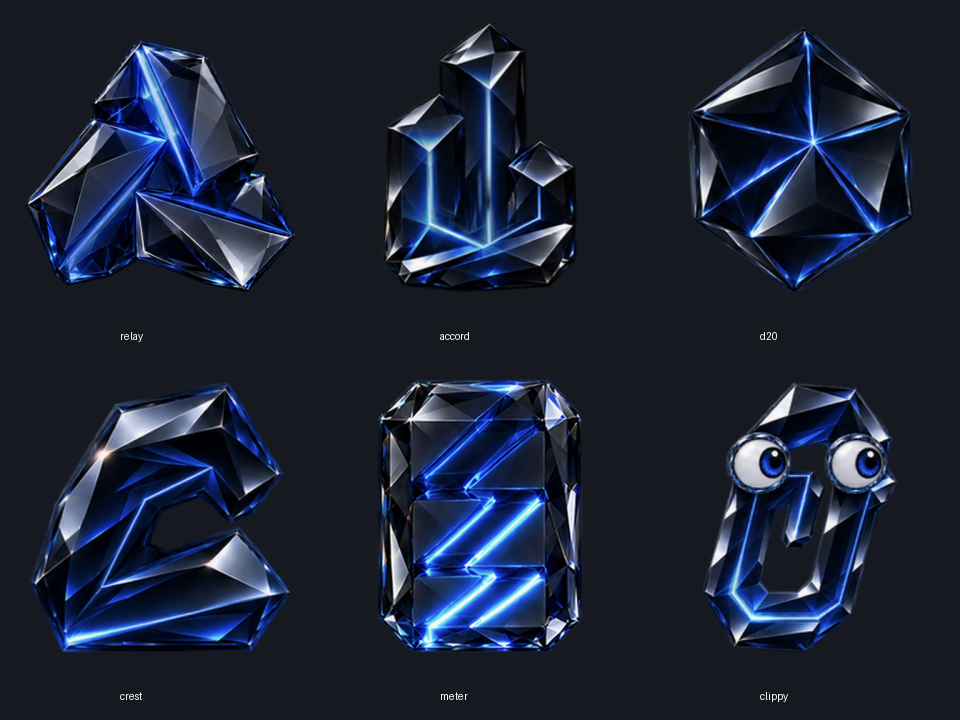
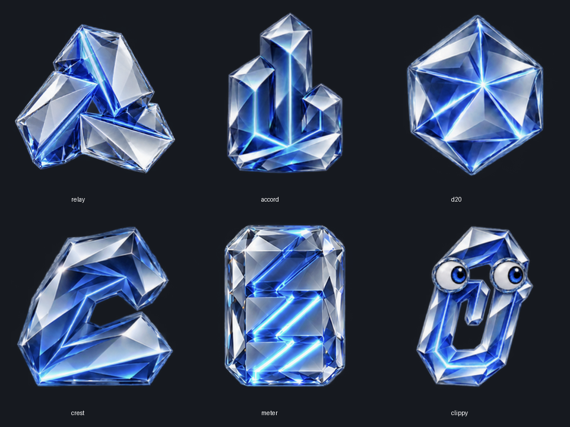

# Avatar family and motion

The six choices are Relay, Accord, d20, Crest, Meter and Clippy. Accord absorbs
Chord's coordinated columns without its curved ribbons; d20 replaces Arc.
Existing `chord` preferences resolve to Accord, and `arc`/legacy `fold` to d20.
Unknown choices resolve to Relay. Palette, finish, pairing and saved messages
are unaffected. Clear and Dark use separate approved artwork, with identical
state choreography and timing. The default remains blue Relay/Clear.

## State authority

The complete, filtered host snapshot drives presentation. Priority is disconnected
(connecting while an explicit connection attempt starts; otherwise still offline),
unread session error, input/approval request, unread completion, work, idle.
Animation never acknowledges an item. Host read receipts remove attention.
The pill keeps its existing semantic colors regardless of artwork palette.
Attention priority chooses the initial reaction, not whether ongoing work can
animate. After a ready/error reaction finishes, the avatar resumes its working
loop if any chats are still working; the unread/error pill and badges remain.
The working clock continues through reactions and repeated snapshots. With no
ongoing work, the reaction settles into its still attention pose.

| State | Motion / light |
| --- | --- |
| Idle | Six-second subtle breathing; Clippy occasionally blinks. |
| Working | Relay circulates three sharp light seams; Accord coordinates column pulses; d20 rotates and breathes; Crest flexes with an additional lower light path; Meter varies its EQ levels over 7.2 seconds with a smooth breathing swell; Clippy remains attentive. |
| Response ready | One sweep and small acknowledgment, then resume ongoing work or settle into a steady pose. |
| Needs input | Two soft pulses followed by a long rest, repeating every six seconds. |
| Error | One brief recoil, then resume ongoing work or remain still; the red pill retains the error indication. |
| Connecting | A measured searching light, distinct from working. |
| Offline / paused | Still, without suggesting ongoing activity. |

Ready/error reactions use host-scoped attention fingerprints. Rebuilding a menu,
refreshing a snapshot, removing an older item, changing finish or reconnecting
must not replay the same reaction. The process remembers the most recent 256
reactions; older evicted events and a fresh app launch may react again. Neither
case changes read state. A new fingerprint may trigger a fresh reaction.

## Native playback

The approved source poses are registered in transparent 320-pixel atlas cells.
Relay and Meter interpolate those phases continuously, including Meter's
breathing transform. Accord, d20, Crest and Clippy use transparent 256-pixel APNG
working loops with motion-compensated interpolation. This exceeds the 192-pixel
requirement of the standard 96-point artwork surface on a 2× display. The alpha
channel is interpolated separately, so there is no baked desktop backdrop.

The monotonic playback clock is independent of timer ticks. Only the selected
shape/finish is loaded; the decoded working-frame cache is limited to 12 frames
and 5 MiB, in addition to the selected source atlas and ImageIO decoder.
Non-blue palettes reuse the native glass-preserving color transform. Blue keeps
the approved colors unchanged. Settings cache small thumbnails rather than
full animation loops. The crystal highlights remain neutral.

Hidden avatars stop their draw timer. Offline and completed one-shot states with
no ongoing work also stop it. Reduce Motion switches immediately to a stable pose and suspends
the timer; it does not hide status or change host activity. Artwork is an
accessible image with the shape and current state in its label. Passive panels,
first-click handling and drag behavior retain the existing nonactivating policy.

## Qualification boundaries

Core tests cover priority, acknowledgement-driven clearing, fingerprint replay,
host scoping, preference migration, reduced motion and bounded choreography.
Native checks cover asset decoding and actual rendering. Working material,
interpolation and Clear/Dark geometry are approved visual variants, not a claim
of a physically simulated 3D model or pixel-identical material conversion.
Signed package, Gatekeeper, upgrade and assistive-technology acceptance are
separate release checks; a source or development build does not qualify them.
